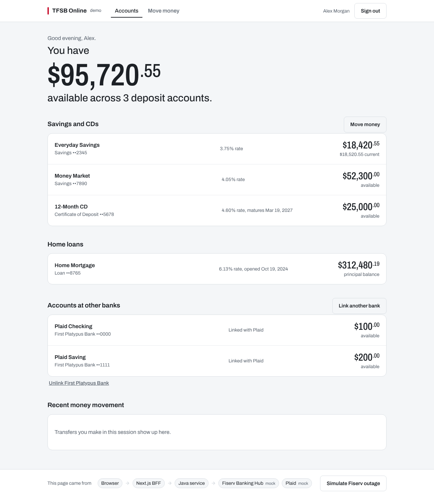

# PSK Bank Online — demo (Next.js BFF + Java + Fiserv Banking Hub + Plaid)

A runnable reference for the architecture in the Fiserv research doc:

```
Browser ──HTTPS, session cookie──▶ Next.js (UI + thin BFF) ──private REST + shared secret──▶ Java banking service
                                                                                              ├──▶ Fiserv Banking Hub (EFX)
                                                                                              └──▶ Plaid
```

- **The browser never sees a Fiserv or Plaid credential.** It talks only to Next.js.
- **Next.js holds no banking secrets.** It owns the session, CSRF, and shaping data for screens.
- **The Java service is the only Fiserv/Plaid caller.** It owns entitlements, limits, idempotency, audit, the circuit breaker and EFX mapping.

Both providers run in **mock** mode out of the box, so the whole app works offline. Flip each one to **live** with your keys.



## Run it (mock mode, about 2 minutes)

You need JDK 21+ and Node 20.9+. No Maven or Gradle downloads: the backend builds with plain `javac`.

```bash
# terminal 1: Java service on :8081
cd backend
./run.sh                 # Windows: run.cmd   (creates backend/.env from .env.example)

# terminal 2: Next.js on :3000
cd web
cp .env.example .env.local
npm install
npm run dev
```

Open http://localhost:3000 and sign in as `alex` with the demo password from `web/.env.local`.

Try these:

1. **Link a bank** on the dashboard. Mock Plaid links "First Platypus Bank".
2. **Move money**: transfer between your accounts (Fiserv Add Transfer), or pull from the linked bank (Plaid verify plus simulated ACH).
3. Open an account to see its transaction history (Fiserv Account Transaction History).
4. **Simulate Fiserv outage** in the footer. You get cached balances, a clear banner, transfers paused and the circuit open. End it to recover.

## Deploy free on Render

`render.yaml` defines both services (free plan): `psk-bank-api` (Java, Docker) and `psk-bank-online` (Next.js).

1. Push this repo to GitHub.
2. In Render: **New → Blueprint**, pick the repo, then fill in the values it asks for:
   `FISERV_API_KEY`, `FISERV_API_SECRET`, `DEMO_PASSWORD`, and `BACKEND_URL` (the API service's URL, e.g. `https://psk-bank-api.onrender.com`).
   The shared secret and session secret are generated for you.
3. Open the `psk-bank-online` URL and sign in as `alex`, `jordan` or `sam`.

Free services sleep after about 15 minutes idle; the first visit after that takes 30–60 seconds while both wake up.
Open the site a minute before a demo. In-memory data (logs, activity, rate limits) resets when they sleep.

## Switch Fiserv to live (your Developer Studio workspace)

1. In Developer Studio, open **Workspaces → your Banking Hub workspace → Credentials**. Copy the **API key**, **API secret**, **Org ID** and **Host URL**.
2. Edit `backend/.env`:
   ```ini
   FISERV_MODE=live
   FISERV_API_KEY=...
   FISERV_API_SECRET=...
   FISERV_ORG_ID=...
   FISERV_HOST_URL=https://bankinghub-cert.fiservapis.com/banking/efx/v1   # use the Host URL shown on your key
   ```
3. Point `FISERV_DEMO_ACCOUNTS` at accounts that exist in the sandbox. The Trial plan is the **shared Premier sandbox**. Sample `AcctId`s are in the Banking Hub **Resources → Postman collection**.
   ```ini
   FISERV_DEMO_ACCOUNTS=SDA:<acctId>:Savings;CDA:<acctId>:My CD;LOAN:<acctId>:Mortgage
   ```
4. Smoke-test before starting the UI:
   ```bash
   cd backend && ./run.sh --check
   # Token OK, expires in ~898s
   #   SDA   ••1234  OK  available=... current=... provider=Premier
   ```
   A `REJECTED ... EFX 1120`-style line means the account id or type isn't in the sandbox. The token step failing means the key, secret or token URL is wrong.
5. `./run.sh`, then reload the web app. The footer's Fiserv chip now says **live**.

Keep `backend/.env` out of Git. It is already in `.gitignore`.

## Switch Plaid to live (Plaid Sandbox)

```ini
PLAID_MODE=live
PLAID_ENV=sandbox
PLAID_CLIENT_ID=...       # Plaid Dashboard → Developers → Keys
PLAID_SECRET=...          # the Sandbox secret
```

**Link a bank** now opens real Plaid Link (sandbox login `user_good` / `pass_good`). The access token is exchanged and stored in Java only.

## What is real vs simulated

| Capability | Fiserv / Plaid call | In this demo |
| --- | --- | --- |
| Account balances, rate, maturity | `POST /acctservice/acctmgmt/accounts/secured` | Real in live mode |
| Transaction history | `POST /accttranservice/acctmgmt/acctTrn/secured` | Real in live mode |
| Transfer between own accounts | `POST /xferservice/payments/transfers` | Real in live mode |
| Link external bank, balances | Plaid `/link/token/create`, `/item/public_token/exchange`, `/accounts/balance/get` | Real in live mode |
| Verify ACH numbers | Plaid `/auth/get` | Real in live mode |
| **ACH pull from external bank** | none in the Banking Hub Premier API set | **Simulated**, labelled in the UI. Production sends it to your ACH originator; the core is credited on settlement. |
| Customer login | none | Demo username/password. Production uses OIDC with your IdP plus MFA. |
| Storage (Plaid tokens, idempotency, audit) | none | In memory. Production uses encrypted DB/KMS and an append-only audit store. |

Banking Hub request rules this code follows (from the Developer Studio docs): every call is `POST`/`PUT`. Reads use `/secured` paths so account numbers never appear in URLs. Each call carries `Authorization: Bearer <token>` and an `EFXHeader` header with JSON (`OrganizationId` required). Tokens come from `POST /fts-apim/oauth2/v2` with Basic auth (API key and secret) and last about 15 minutes, and `expires_in` is in **milliseconds**.

## Security built into the demo

- Session: HMAC-signed, `HttpOnly`, `SameSite=Lax`, `Secure` in production, 15-minute lifetime.
- CSRF: the token is bound into the signed session and checked on every BFF mutation, plus an Origin check.
- Entitlements: the Java service maps the session user to allowed accounts and checks on **every** call. The browser only sees opaque ids (`acc-1`) and masked numbers.
- Java trusts only the BFF: shared secret (constant-time compare) and a user id header. It binds to `127.0.0.1` by default.
- Money movement: an `Idempotency-Key` per intended transfer, in-flight de-duplication, no automatic retry on timeout ("unknown" rather than "failed"), per-transfer limits, and an audit line for every attempt.
- Resilience: timeouts, a circuit breaker (3 failures, then 30s fail-fast), and a last-good read model with a stale banner.
- Headers: CSP (allows Plaid's CDN only), HSTS, `X-Frame-Options: DENY`, `nosniff`.

## Verify the live transports without real keys

```bash
backend/test/contract-test.sh     # needs python3 + curl
```

This starts local fakes that **reject** anything off-contract (wrong token auth, missing or invalid EFXHeader, wrong Plaid keys or version). It then runs the Java service in live mode against them and checks the mappings. Expected result: `7 passed, 0 failed`.

## Project map

```
backend/                         Java 21, zero dependencies
  src/main/java/com/pskbank/demo/
    App.java                     wiring, routes, error mapping, --check
    fiserv/  LiveFiservTransport (token + EFXHeader), MockFiservTransport (Premier-like core),
             EfxMapper (EFX <-> domain), FiservPaths
    plaid/   LivePlaidTransport, MockPlaidTransport, PlaidService
    banking/ Entitlements, CoreBankingService (breaker + cache), TransferService,
             ExternalFundingService, AuditLog
    core/    Router (JDK HttpServer), Json, Config, CircuitBreaker, HttpJson
  test/contract-test.sh          live-transport contract test
web/                             Next.js 16 App Router
  app/api/**/route.ts            BFF route handlers (guarded, whitelisted fields, relay to Java)
  lib/session.ts, bff.ts         signed session, CSRF + origin guard
  lib/backend.ts                 the BFF's only outbound client (Java service)
  app/page.tsx, move-money/, accounts/[id]/   server-rendered pages
  components/                    client islands: forms, Plaid Link, outage toggle
```

## Moving to the production stack

- **Spring Boot**: each Java class maps across one-to-one. `Router` becomes `@RestController`, `HttpJson` becomes `RestClient`, `Json` becomes Jackson, `CircuitBreaker` becomes Resilience4j, and `Config` becomes `application.yml` plus Vault.
- **Identity**: replace `/api/auth/login` with OIDC (authorization code + PKCE) and step-up MFA before money movement.
- **Data**: Postgres for entitlements and idempotency keys, KMS-encrypted Plaid tokens, an append-only audit table shipped to the SIEM.
- **Network**: Java on a private subnet, mTLS between BFF and Java, egress allowlist to Fiserv and Plaid hosts only.
